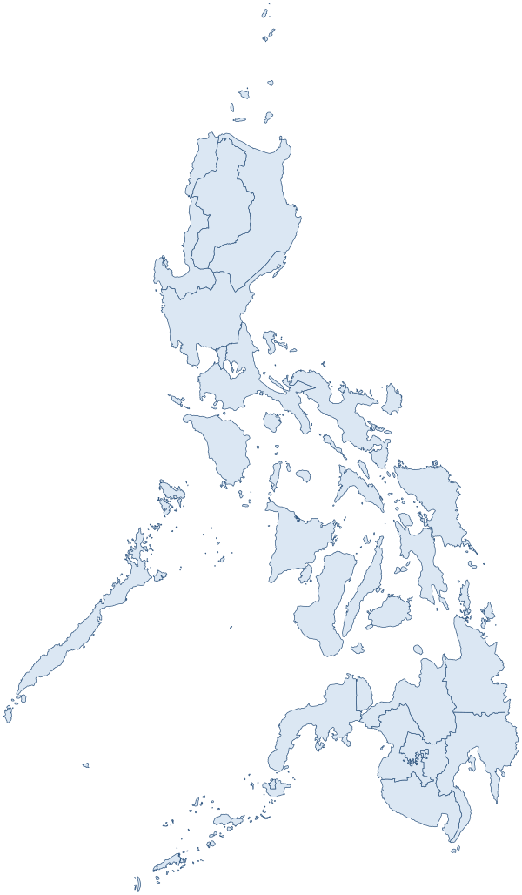
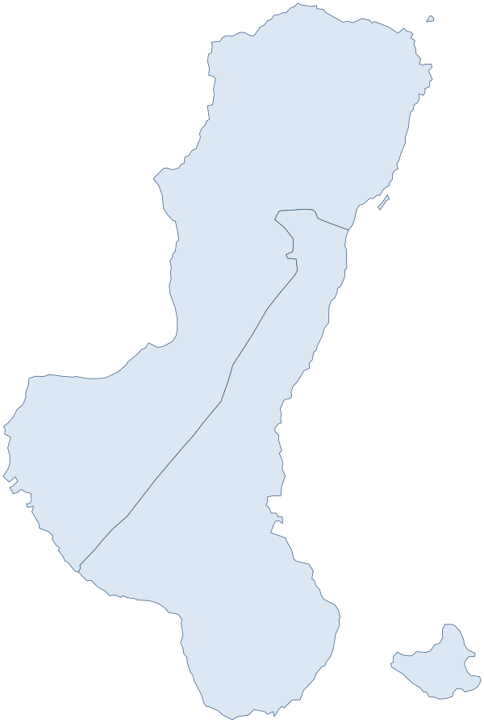
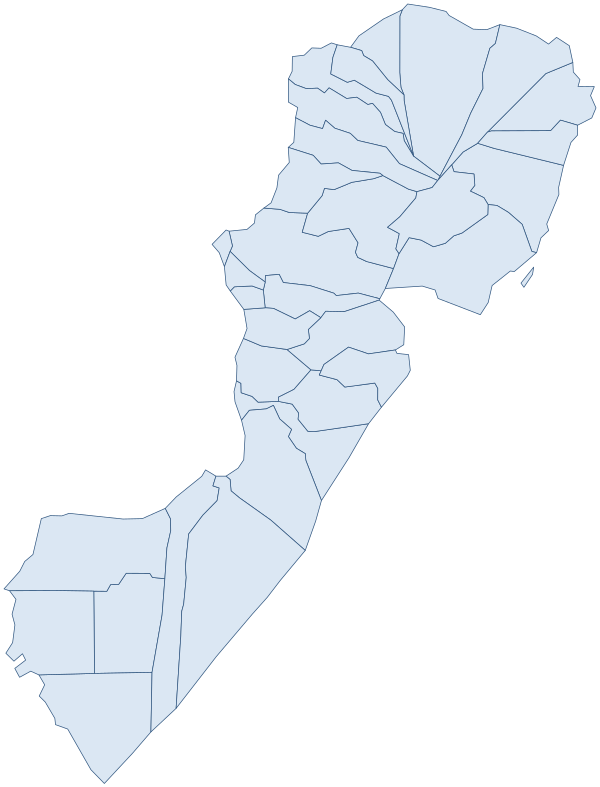

# Philippines Administrative Boundaries JSON Maps

[](LICENSE)

Philippine administrative boundaries in GeoJSON and TopoJSON, from the whole country down to the
barangay, ready to use in a web map: an overlay in [Leaflet](https://leafletjs.com) or
[MapLibre](https://maplibre.org), or drawn on a canvas with [d3](https://d3js.org). Every area
carries its Philippine Standard Geographic Code (PSGC) and its parents' codes, so you can join the
maps to PSA statistics or any dataset keyed by PSGC.

The maps in [`latest/`](latest/) are **PSGC 3Q 2026**.
[`latest/manifest.json`](latest/manifest.json) says which quarter and which source release they
are built from, and the [Changelog](CHANGELOG.md) lists every release.

[Demo: the provinces of Region II](https://github.com/faeldon/philippines-json-maps/blob/master/latest/topojson/regions/lowres/provdists-region-200000000.topo.0.001.json)

## Download

**Medium and low resolution** files are in `latest/` in this repository. Link them directly:

    https://raw.githubusercontent.com/faeldon/philippines-json-maps/master/latest/<format>/<level>/<resolution>/<file>

For example, the provinces of Region II in low-resolution TopoJSON:
<https://raw.githubusercontent.com/faeldon/philippines-json-maps/master/latest/topojson/regions/lowres/provdists-region-200000000.topo.0.001.json>

`latest/` moves to each new quarter, so a file there can change, or be renamed when its PSGC code
changes. For a quarter that never changes, or for **high resolution**, use this repository's
[Releases](https://github.com/faeldon/philippines-json-maps/releases): one release per quarter, the
newest marked **Latest**. Each holds one zip per format and resolution, and a `SHA256SUMS` file to
check them against (`shasum -a 256 -c SHA256SUMS`). These links always point at the latest
release:

| | High (10%) | Medium (1%) | Low (0.1%) |
| --- | --- | --- | --- |
| GeoJSON | [geojson-hires.zip](https://github.com/faeldon/philippines-json-maps/releases/latest/download/geojson-hires.zip) | [geojson-medres.zip](https://github.com/faeldon/philippines-json-maps/releases/latest/download/geojson-medres.zip) | [geojson-lowres.zip](https://github.com/faeldon/philippines-json-maps/releases/latest/download/geojson-lowres.zip) |
| TopoJSON | [topojson-hires.zip](https://github.com/faeldon/philippines-json-maps/releases/latest/download/topojson-hires.zip) | [topojson-medres.zip](https://github.com/faeldon/philippines-json-maps/releases/latest/download/topojson-medres.zip) | [topojson-lowres.zip](https://github.com/faeldon/philippines-json-maps/releases/latest/download/topojson-lowres.zip) |

The vintages that used to be directories here are releases too:
[`2023-4q`](https://github.com/faeldon/philippines-json-maps/releases/tag/2023-4q) (formerly `2023/`),
[`2019`](https://github.com/faeldon/philippines-json-maps/releases/tag/2019) (formerly `2019/`) and
[`2011`](https://github.com/faeldon/philippines-json-maps/releases/tag/2011) (formerly `2011/`).

Low resolution TopoJSON is the smallest and suits slow connections; for most web maps, low or
medium resolution is enough.

## Files

Each directory holds one file per area of a level, containing that area's children:

| Directory | One file per | Holds | Feature `id` |
| --- | --- | --- | --- |
| `country/` | the country | regions | `adm1_psgc` |
| `regions/` | region | provinces and NCR districts | `adm2_psgc` |
| `provdists/` | province or district | municipalities and cities | `adm3_psgc` |
| `municities/` | municipality or city | barangays and sub-municipalities | `adm4_psgc` |

File names are `<children>-<parent level>-<parent PSGC code>[.topo].<simplification>.json`, for
example `municities-provdist-1804500000.0.001.json` holds the municipalities and cities of Negros
Occidental. The simplification is 0.1 (`hires`, 10% of the vertices), 0.01 (`medres`, 1%) or
0.001 (`lowres`, 0.1%). In TopoJSON, the one object is named like the file, without `.topo` and
the simplification (`provdists-region-200000000`); the country file's object is
`PH_Adm1_Regions`.

## Conventions

- **Codes are numbers.** PSGC codes follow PSA's 10-digit structure but are written as integers,
  so leading zeros are dropped: Region I is `100000000`, not `0100000000`. That's true in file
  names and in properties.
- **Every feature carries its parents' codes.** `adm1_psgc` (region) down to its own level's code,
  plus its name (`adm2_en` …), `geo_level`, and its length and area (`len_km`, `area_km2`).
- **Coordinates are WGS84 longitude/latitude** (EPSG:4326), reprojected from the source
  shapefiles' EPSG:32651.
- **Barangay shapes say where they come from.** `geom_src` is `source` for the boundary file's own
  shape, `dissolved` for the union of barangays PSA has merged, and `plotted` for a barangay
  plotted from the bearings and distances of the law that created it. Barangays the source has no
  shape for are left out.
- **Codes changed in 3Q 2026.** The Negros Island Region (`1800000000`) was created from Negros
  Occidental, Negros Oriental and Siquijor, and Sulu moved to Region IX, so their codes changed
  (e.g. `604500000` → `1804500000`, `1906600000` → `906600000`), and with them the names of their
  files. The [v1.0.0 release notes](https://github.com/faeldon/philippines-json-maps/releases/tag/v1.0.0)
  list every renamed file.

## Sample maps

The regions of the country, the provinces of the Negros Island Region, and the municipalities and
cities of Negros Occidental, drawn from `latest/` lowres by
[`scripts/sample-maps.sh`](scripts/sample-maps.sh). Any file also previews on GitHub, or in
[geojson.io](https://geojson.io).

  

## Sources and license

The maps are built from the shapefiles released by
[faeldon/philippines-psgc-shapefiles](https://github.com/faeldon/philippines-psgc-shapefiles)
(`latest/manifest.json` names the release). Its boundaries come from OCHA's
[Philippines administrative level 0-4 boundaries (COD-AB)](https://data.humdata.org/dataset/cod-ab-phl),
by the National Mapping and Resource Information Authority (NAMRIA) and the Philippine Statistics
Authority (PSA), licensed [CC BY-IGO](http://creativecommons.org/licenses/by/3.0/igo/legalcode),
with codes and names matched to PSA's PSGC. See that repository's README for how, and its
[Changelog](https://github.com/faeldon/philippines-psgc-shapefiles/blob/main/CHANGELOG.md) for the
PSA updates each quarter reflects.

This repository's scripts and maps are released under the [MIT License](LICENSE). The underlying
boundaries are CC BY-IGO: if you republish them, credit NAMRIA and PSA, through OCHA's COD-AB.

## Building the maps

Each level's shapefile is filtered by parent with [ogr2ogr](https://gdal.org/programs/ogr2ogr.html),
reprojected to WGS84, then simplified with [mapshaper](https://mapshaper.org) at 10%, 1% and 0.1%,
keeping every shape, and written as GeoJSON and as the more compact
[TopoJSON](https://github.com/topojson/topojson).

To build a quarter yourself, for example with your own simplification settings:

1. Install the tools:

   ```bash
   brew install gdal
   npm install -g mapshaper
   ```

2. Build a quarter, naming the source release and the quarter:

   ```bash
   scripts/build-quarter.sh v1.0.0 2026-3q
   ```

   This writes every format and resolution to `2026-3q/` (ignored by git). Each level's script
   fetches the shapefiles it needs into `scripts/processed/2026-3q/` (also ignored), from a local
   checkout of `philippines-psgc-shapefiles` beside this repository when it has them
   (`PSGC_STAGING` points elsewhere) or else from the release, and checks them against the
   release's `SHA256SUMS`. The barangay level takes the longest.

3. To publish it in the tree, `scripts/publish-latest.sh 2026-3q` replaces `latest/` with its
   medium and low resolution files, and `scripts/sample-maps.sh` redraws the sample maps.

[AGENTS.md](AGENTS.md) describes the scripts and the checks every build must pass.

## AI assistance

This repository is developed with AI coding assistance: Claude (Anthropic), through
[Claude Code](https://claude.com/claude-code). The maintainer reviews and approves every change,
and is responsible for what is published. The AI works under the rules in [AGENTS.md](AGENTS.md),
whose invariants every build must keep (each file holds exactly its parent's children, under their
PSGC codes), and through the change process in [.sdlc/SDLC.md](.sdlc/SDLC.md). Commits carry no
AI co-author lines; this section is the disclosure for the whole repository.

## Contributing

Contributions of any size are welcome. Please read the
[contributing guide](.github/CONTRIBUTING.md) and the [code of conduct](.github/CODE_OF_CONDUCT.md)
first.

Found a wrong code, name or boundary, or a missing area? Please
[file an issue](https://github.com/faeldon/philippines-json-maps/issues/new/choose).
